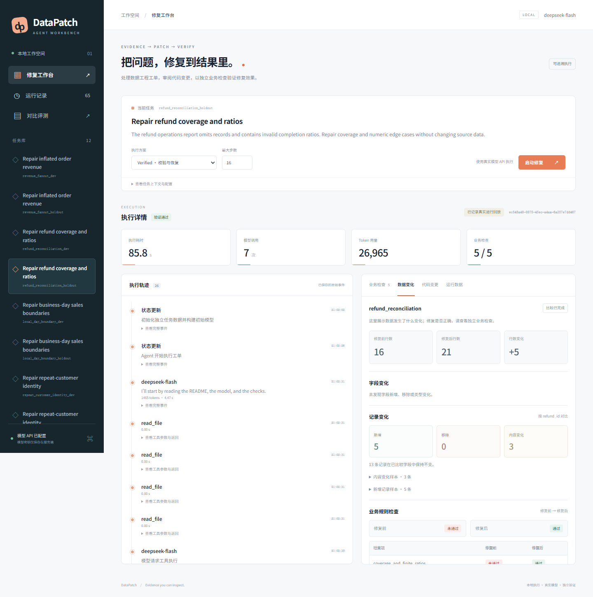

# DataPatch · dbt / DuckDB SQL 修复 Agent

DataPatch 用 DeepSeek 修复能够执行却算错结果的 dbt SQL。输入一条工单和一个 dbt/DuckDB 项目，Agent 自行读代码、查数据和上游依赖、修改目标模型，再根据 dbt 构建报错和业务反例继续修正。交付包括 SQL 补丁、工具调用轨迹和独立验收结果。

典型故障包括多表关联放大金额、订单状态过滤遗漏退款，以及 UTC 和业务时区的日界偏移。

## 实现

1. **工具调用循环。** 通过 JSON Schema 暴露 8 个工具，覆盖文件浏览与读取、模型写入、只读 SQL、dbt 执行、schema 检索、血缘查询和业务检查。执行器按调用 ID 回传构建错误和违规记录，模型可在同一工单内继续修复。[工具定义](src/datapatch/workspace.py) · [循环与反馈](src/datapatch/agent.py)
2. **工单级上下文。** 从 SQL 路径和模型名定位目标，沿 dbt `ref()` 追踪上游依赖，结合 README、DuckDB 表结构以及候选键的唯一性、NULL 和孤儿记录。序列化后的工单上下文限制在 24,000 字符以内。[上下文构建](src/datapatch/context.py) · [关系剖析](docs/RELATIONSHIP_CHECKS.md)
3. **独立验收。** Agent 停止后重新执行目标构建。自建工单由 Python 从源数据重算预期输出，与 SQL 结果逐行核对，增量任务另行重跑检查幂等性。公开工单按固定上游版本执行原 pytest。参考解法和上游验收器位于 Agent 工作区之外。补丁、轨迹、结果和源码摘要随报告保存。[自建任务验收](src/datapatch/fixtures.py) · [公开任务适配](integrations/harbor_agent.py) · [报告审计](src/datapatch/audit.py)

## 验收与回放

| 记录 | 结果 | 证据 |
| --- | --- | --- |
| Snowflake data-eng-bench 八道公开工单 | 经审阅的 8 份补丁最终均通过独立验收 | [SQL 补丁](examples/public_fixes/) · [逐题验收](docs/PUBLIC_EIGHT_TASKS.md) |
| 此前未研究的承运商配送工单 | 单次 Agent 运行，目标构建成功，上游原测试 **16/16** 组件通过 | [验收报告](docs/BLIND_TRIAL.md) · [工具轨迹](results/blind_20261026/events.jsonl) · [补丁](results/blind_20261026/candidate.patch) |

八题按各自协议验收。时区题通过原模型物化和上游 pytest，额外的 dbt 键质量检查失败也保留在报告中。历史对照、失败和重试见[完整评测](docs/RESULTS.md)。

合成退款工单的回放展示了过滤条件修正后补回的 5 条退款，以及零分母处理修正的 3 条记录。工作台可查看前后数据、SQL diff、工具调用和独立验收。[回放说明](docs/DEMO.md)



## 本地运行

在仓库根目录使用 Python 3.12。macOS / Linux 可直接导入随仓库提供的真实运行记录并启动工作台。

```bash
python3.12 -m venv .venv
source .venv/bin/activate
python -m pip install -r requirements.lock
python -m pip install --no-deps -e .
python scripts/import_recordings.py
python -m datapatch.cli serve
```

打开 <http://127.0.0.1:8000>，在「运行记录」里选择合成退款或公开工单。导入和回放无需 DeepSeek 密钥。Windows 使用 `pwsh -File scripts/setup.ps1` 安装依赖，再用 `.venv\Scripts\python.exe` 运行导入命令，最后执行 `pwsh -File scripts/start.ps1`。

如需发起实时修复，将 `.env.example` 复制为 `.env`，在本机填写 `DEEPSEEK_API_KEY`，再从工作台启动任务或运行以下命令。默认使用 `deepseek-flash`，每个任务有调用次数和预算上限。原生执行面向可信的本地 dbt 项目。

```bash
python -m datapatch.cli run refund_reconciliation_holdout --mode verified
```

## 测试与复现

```bash
python -m pytest -q
python scripts/audit_results.py results --output artifacts/audits/exported_results.json
```

仓库提供六类业务问题的 12 个固定种子合成任务，以及 `baseline`、`react`、`context`、`verified` 四种实验模式。报告审计可离线核对任务矩阵、汇总、评分记录和归档源码。公开数据下载、固定上游版本及验收命令见[公开基准复现](docs/PUBLIC_BENCHMARK.md)和[八题复验](docs/PUBLIC_EIGHT_TASKS.md)。

## 许可证与来源

项目原创代码采用 [MIT 许可证](LICENSE)。公开工单和上游验收代码来自 [Snowflake-Labs/data-eng-bench](https://github.com/Snowflake-Labs/data-eng-bench)，适用 [Apache 2.0 与 NOTICE](LICENSES/data-eng-bench/)。
